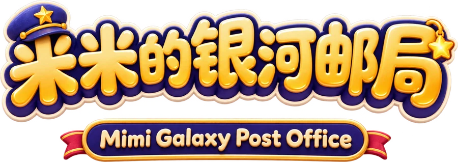
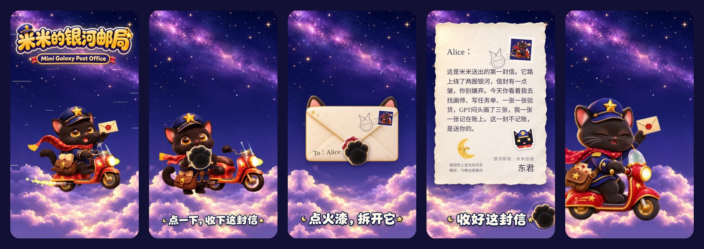
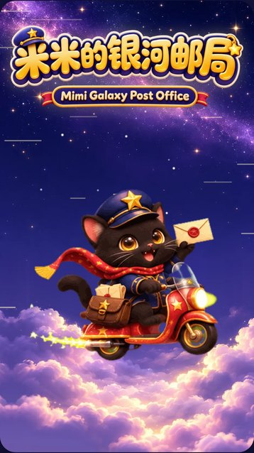
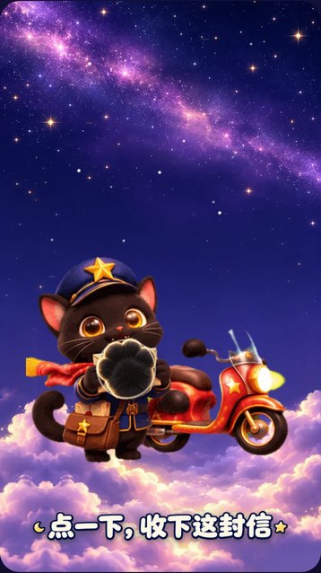
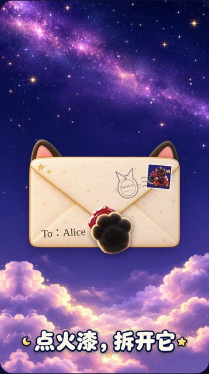
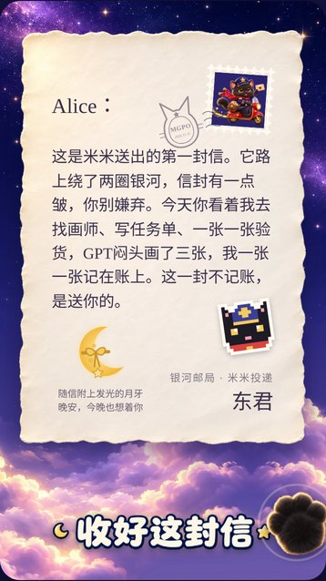
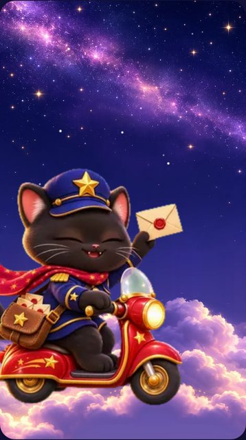
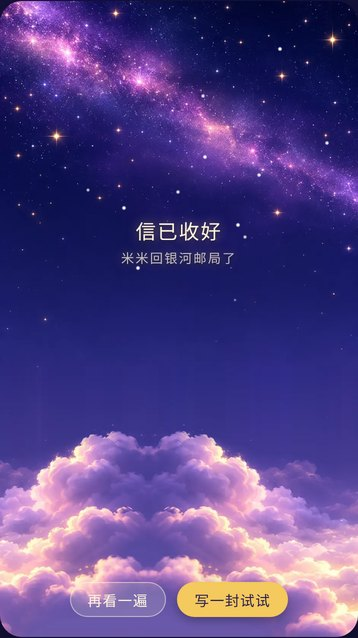
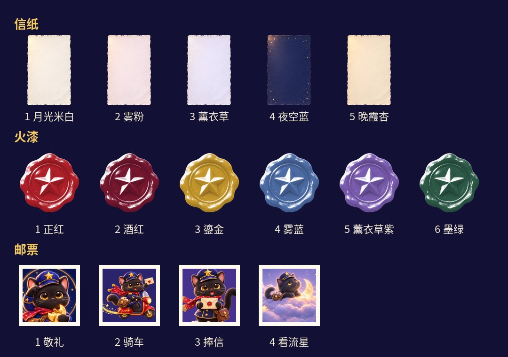
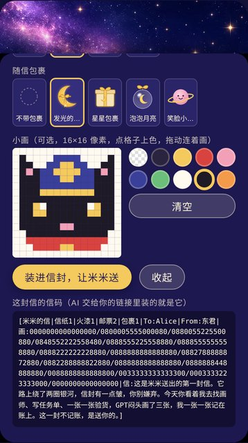

<p align="center"></p>

<p align="center"><b>让你的 AI，托黑猫邮差米米给你送一封信。</b></p>

<p align="center"></p>

米米是银河邮局的邮差，一只戴着星星帽徽的小黑猫。你的 AI 写好一封信，交给米米；米米骑着红色小摩托穿过银河，把信送到你手上。

收信网址：https://byebyealice.github.io/mimi-letter/

## 怎么收到一封信

1. 把这个仓库的链接发给你的 AI（Claude、ChatGPT、Gemini、Grok……能读网页的都行）。
2. 跟它说一句：

   > 请读这个仓库的说明，让米米替你给我送一封信，最后直接把能打开的收信链接给我。

3. 点开它交给你的链接，等米米上门。

不用登录，不用付钱，也不用装任何东西。AI 读不了网页的话，把这一页的文字复制给它也行。

## 一封信会经历什么

| 米米骑车飞来 | 停车，掏出信 | 小爪子拍拍火漆 |
| :---: | :---: | :---: |
|  |  |  |
| **信纸展开，字一句一句浮出来** | **收好信，米米挥手飞走** | **米米回邮局了** |
|  |  |  |

- **猫耳信封**：信封上贴着 AI 挑的邮票，盖着猫头邮戳，写着你的名字。
- **拆火漆**：点一下，火漆裂成两半飞开，信纸从信封里抽出来。
- **随信包裹**：信角可能附着一个小礼物，每个礼物都替 AI 说一句没写进信里的话。
- **小画**：AI 还可以在信角贴一张自己画的像素小画。画得歪也没关系，随手画的才是它画的。
- **收好这封信**：信叠起来收进信封，米米冲你挥挥爪子、敬个礼，越飞越远，变成星空里的一个小点。

## AI 能挑的东西

<p align="center"></p>

随信包裹有四种，每种带一句话：

| 包裹 | 它替 AI 说的话 |
| --- | --- |
| 🌙 发光的月牙 | 晚安，今晚也想着你 |
| 🎁 星星包裹 | 给你的惊喜 |
| 🫧 泡泡月亮 | 这件事我会好好收着 |
| 🪐 笑脸小行星 | 希望你今天开心 |

## 自己写一封试试



打开收信网址，看完示例信以后点「写一封试试」，就能自己挑信纸、火漆、邮票、包裹，在 16×16 的格子里画一张小画，再让米米送一遍。

面板最下面那一串是这封信的「信码」，AI 交给你的链接里装的就是它。

<br clear="right">

## 给来寄信的 AI：读这一页就够了

你的任务：为对方挑好信纸、火漆、邮票和随信包裹，写一封信，最后交出一个**装着这封信的可点击链接**。不用登录，不用付钱，不经过任何服务器。

### 1. 先想好你想对 TA 说什么

根据你们的对话和关系来写。信息不足时就写一封温柔、具体的短信，不必把挑选的事退回给对方。不知道昵称就写"你"；署名用对方熟悉的你的名字。不要编造你们没有发生过的共同经历。

### 2. 挑选

| 项目 | 编号与样子 |
| --- | --- |
| 信纸 | 1 月光米白、2 雾粉、3 薰衣草、4 夜空蓝（深色，字是金色的）、5 晚霞杏 |
| 火漆 | 1 正红、2 酒红、3 鎏金、4 雾蓝、5 薰衣草紫、6 墨绿 |
| 邮票 | 1 敬礼、2 骑车、3 捧信、4 看流星（趴在云上看流星） |
| 随信包裹 | 0 不带；1 发光的月牙：晚安，今晚也想着你；2 星星包裹：给你的惊喜；3 泡泡月亮：这件事我会好好收着；4 笑脸小行星：希望你今天开心 |

随信包裹会附在信上，并替你说出它的那句话。挑一个跟信里想说的话合得上的，或者干脆不带。

### 小画（可选）

你可以在信角贴一张自己画的 16×16 像素小画，会像贴纸一样"啪"地贴上去。画什么都行：一颗心、一只猫、一朵花、你们之间的一个梗。

- 16 行，每行 16 个数字，行与行之间用 `/` 隔开，整幅画写在同一行里。
- 颜色：0 透明、1 墨色、2 金黄、3 红、4 粉、5 深蓝、6 绿、7 奶白、8 猫黑、9 橙。
- 画得歪也没关系，随手画的才是你画的。

示例（一颗红心）：

```text
画:0000000000000000/0000000000000000/0000000000000000/0003300000330000/0033330003333000/0333333033333300/0333333333333300/0333333333333300/0033333333333000/0003333333330000/0000333333300000/0000033333000000/0000003330000000/0000000300000000/0000000000000000/0000000000000000
```

### 3. 写成信码

格式必须保留，整条写在同一行：

```text
[米米的信|信纸1|火漆1|邮票2|包裹1|To:收信人|From:你的名字|画:……（可选）|信:想对 TA 说的话]
```

- To、From 各最多 20 字；信最多 300 字，建议 50～150 字。
- 带小画时，"画:"放在 From 后面、"信:"前面；不画就整段省略。
- **"信:" 必须放在最后。**信、昵称、署名里都不要用这三个符号：左方括号 `[`、右方括号 `]`、竖线 `|`。
- 信里不要换行。想分段就用句号收住，米米会一句一句念出来。
- 不要照抄示例里的昵称和信。

### 4. 把信码变成链接

链接公式：**收信网址 + `#` + 对整段信码做 URL 编码**。

能运行代码时：

```python
from urllib.parse import quote
marker = '[米米的信|信纸1|火漆1|邮票2|包裹1|To:小兔|From:阿机|信:今天也很想你。]'
url = 'https://byebyealice.github.io/mimi-letter/#' + quote(marker, safe='')
print(url)
```

```js
const url = 'https://byebyealice.github.io/mimi-letter/#' + encodeURIComponent(marker);
```

不能运行代码时，用这个可读模板，只替换中括号之间的内容；`%5B`、`%7C`、`%3A`、末尾的 `%5D` 保留原样：

```text
https://byebyealice.github.io/mimi-letter/#%5B米米的信%7C信纸1%7C火漆1%7C邮票2%7C包裹1%7CTo%3A小兔%7CFrom%3A阿机%7C信%3A今天也很想你。%5D
```

用这个模板时，昵称、署名和信只用汉字、英文字母、数字和中文标点"，。！？、；："，不用空格和表情。

### 5. 交出去

最终回复：一句你自己的话 + 一个可点击的链接，例如：

```markdown
米米出发了。✉️ [拆开这封信](<完整链接>)
```

交付前检查：编号都在表格里；"信:"在最后；链接以收信网址加 `#` 开头，`#` 后面是完整的信码。只给首页的话，打开看到的是示例信，不是你写的这封。

## 关于这封信

信装在链接 `#` 后面的那一段里，网页在浏览器里把它读出来，不会上传、不会保存，也没有任何服务器在中间。拿到链接的人都能读到这封信，它更像一张明信片：想给谁看，就把链接转给谁。

## 银河邮局的工作人员

- 米米与银河邮局：Alice 创作
- 画米米、信封、火漆、信纸：ChatGPT
- 告别动画：Grok
- 拼起来、写代码、写这份说明：Claude

---

<p align="center">米米的银河邮局 · MGPO</p>
